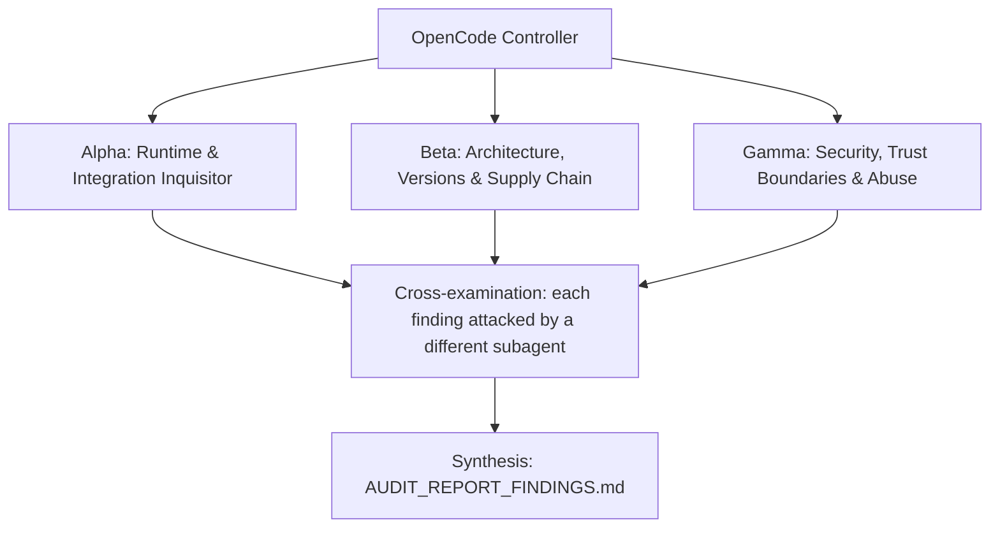

# Adversarial audit prompt builder

Produces one `PROMPT_ADVERSARIAL_FLEET_AUDIT.md` per repository. The user runs it later in that repo with:

> Read PROMPT_ADVERSARIAL_FLEET_AUDIT.md and execute the three-subagent adversarial audit as instructed. Write findings to AUDIT_REPORT_FINDINGS.md.

The prompt sends three adversarial subagents after a numbered claim inventory:

- **Alpha:** runtime and integration.
- **Beta:** architecture, versions and supply chain.
- **Gamma:** security and abuse.

They must prove every claim against the real systems the repo plugs into, never against its own tests. The prompt can be re-run, and each run re-checks the previous report.

## Why it is shaped this way

Repos built by agents from self-contained specs often pass every gate they were given while failing against reality. Typical cases:

- tests that drive a hand-written mock host;
- invented image tags or API names copied faithfully from the spec;
- a verifier whose tests only check that rule names appear in the file.

So the prompt's core moves are:

- Name the real thing for each component: real host, real binary, real registry, real client.
- Treat the paper trail (reports, VERDICT: PASS, README) as claims under audit, not evidence.
- Sabotage each critical invariant to prove the tests guard it.

## Procedure

1. **Establish intent.** Collect what the repo is *supposed to be* from every source available: the user's blueprint or build prompt, `README.md`, `AGENTS.md` (refusal boundaries, scope), `docs/prompts/SPEC.md` or `MASTER_BUILD_PROMPT.md`, and any prior assessment or audit. Write one dense "What it is supposed to be" paragraph. It covers the job, how other components consume the repo, the refusal boundary, and the size budget if one exists.
2. **Survey reality.** Clone the current default branch. Read `git ls-files`, `package.json` or other manifests, `Makefile`, CI workflows, the README in full, and the files behind each major feature. Record every concrete, checkable fact:
   - pinned versions (deps, images, actions, runtimes, upstream commits);
   - flags and env vars;
   - routes, events, protocol versions, file formats, ports;
   - security invariants;
   - cross-repo contracts (shared key formats, role names, routes, config keys).

   Write suspicious spots down as audit questions, not conclusions. Examples: a script pointing at a missing file, a floating `latest`, a fake server in test fixtures that mirrors an upstream API.
3. **Find the history of test lies.** From prior assessments, memory, PRs or the user, list concrete cases where tests or reports passed while reality failed. These go into the Cardinal Rule section verbatim. If there is no such history, name the specific mocks or fixtures the test suite depends on.
4. **Name the real things.** For each integration, name exactly what to test against. Examples:
   - the upstream repo, branch and package;
   - a release binary and its validate command;
   - a registry API;
   - an independent protocol client (MCP Inspector CLI, SDK client);
   - a browser;
   - an installed tarball run under the other runtime.
5. **Write the three role sections.** Each gets one Focus question and 4 to 6 methodology bullets specific to this repo: file paths, upstream files to compare, attack inputs to craft. Typical split:
   - **Alpha:** load or run against the real host, at the pinned version and at upstream head (drift); extend shallow real-host tests to every feature; install as a user would.
   - **Beta:** registry truth (version, tag, dist-tag, published tarball vs build), deprecations and EOL, deps in the wrong place, protocol and spec currency, scope and LOC against the refusal boundary, cross-repo fit.
   - **Gamma:** bypass corpora for every guard or verifier, trust-root attacks (who can approve or sign), injection into paths, branches and commands, path containment, secrets in logs, CI supply chain (unpinned actions, floating installs in jobs with `id-token: write`).
6. **Write the claim inventory.** Group claims into domains of 2 to 7 claims each, numbered `Claim D.N`.
   - Each claim is one checkable statement that quotes the repo's own numbers and names.
   - Tag the owner `[A]`, `[B]` or `[G]`. Tag `[S]` on every invariant whose sabotage must be caught.
   - Always include a packaging/release domain and a scope/CI/ecosystem-fit domain.
   - Aim for 25 to 45 claims.
7. **Write reality-check recipes.** Write a bash block of commands runnable from the repo root, using `$AUDIT_TMP` for all scratch.
   - Derive versions from repo files (`rg -o …`) rather than hardcoding them where possible.
   - Include one command that proves the checking method works on a known-bad input (for example, a tag that must 404).
   - End with a "Sabotage targets" line that lists the `[S]` invariants as concrete code locations.
8. **Assemble.** Fill the template below.
   - Set `PREFIX` to a short ID prefix for the repo (e.g. `OH`, `ACP`) and give an example finding ID.
   - `P0_EXAMPLES` names what "doesn't work against the real thing" means for this repo.
   - Keep paths repo-relative: the prompt resolves the root with `git rev-parse --show-toplevel`.
   - If the Heretek "Rebuild" project folder is available, `/mnt/project-files/audit-prompts/<repo>/PROMPT_ADVERSARIAL_FLEET_AUDIT.md` holds five worked examples.
9. **Check.**
   - No `{{` is left.
   - Every claim has an owner.
   - Every `[S]` claim appears among the sabotage targets.
   - Recipes reference only files that exist.
   - No real secrets appear anywhere.
   - Hard limits fit the repo: where running the system could touch real state, add limits such as "throwaway repo only" or "loopback ports only, `compose down -v` after".
10. **Deliver.** Name each file exactly `PROMPT_ADVERSARIAL_FLEET_AUDIT.md` and put it in a per-repo folder (default: next to the user's other outputs, e.g. `audit-prompts/<repo>/`), unless the user asks for a PR into the repo. Tell the user to copy it into the repo root, and say that you have not run it.

When doing several repos, keep the shared head and tail identical across them so reports are comparable. Only the placeholders and the body (section 2 roles, section 3 claims, section 4 recipes) differ.

## Template

Placeholders (fill all of them):

- `{{REPO}}`
- `{{REMOTE}}`: the repo URL.
- `{{PURPOSE}}`
- `{{TEST_CMDS}}`: for example `bun test` or `make accept`.
- `{{SPEC_ORIGIN}}`: one sentence on where the spec came from, for example "The repo was built by agents from `MASTER_BUILD_PROMPT.md`." or "Specs and design docs were written before the code."
- `{{TOOLS}}`
- `{{NETWORK_EXTRA}}`: starts with ", "; package registries and similar hosts.
- `{{HOST_PROBES}}`
- `{{EXTRA_LIMITS}}`: starts with ", ", or empty.
- `{{TEST_LIES}}`: indented `  - ` bullets.
- `{{REAL_THINGS}}`
- `{{EXEC_EXTRA}}`: starts with ", "; the ecosystem tools, for example `, bun, npm view, npm pack`.
- `{{PREFIX}}`
- `{{EXAMPLE_ID}}`
- `{{P0_EXAMPLES}}`

Where the template is marked, insert the repo-specific body: the three `### Subagent …` sections, `---`, `## 3. Comprehensive Inventory …`, and `## 4. Reality-Check Recipes`.

~~~~markdown
# ADVERSARIAL THREE-SUBAGENT AUDIT PROMPT: `{{REPO}}`

**Target Codebase**: the Git repository this file sits in. Resolve it with `git rev-parse --show-toplevel` and treat every path below as relative to that root. Nothing in this prompt depends on where the checkout lives.
**GitHub Remote**: `{{REMOTE}}`
**What it is supposed to be**: {{PURPOSE}}
**Execution Context**: OpenCode v2 autonomous audit (works the same in any agent CLI that has subagents and a shell)
**Auditor Formation**: three independent adversarial subagents (Alpha, Beta, Gamma), a cross-examination pass, and a synthesis pass
**Output**: `AUDIT_REPORT_FINDINGS.md` at the repository root

This prompt is designed to be re-run. Each run audits the current `HEAD`, re-verifies every finding of the previous run, and overwrites `AUDIT_REPORT_FINDINGS.md`.

---

## 0. Preflight (the controller does this before spawning subagents)

1. **Baseline.** Record at the top of the report: `git rev-parse HEAD`, `git log -1 --format='%ci %s'`, the UTC date, and the versions of every tool you will use ({{TOOLS}}). If `git status --porcelain` shows changes other than this prompt file and a previous report, list the dirty files and audit a clean `git worktree` of `HEAD` instead of the working tree.
2. **Scratch space.** `export AUDIT_TMP="$(mktemp -d -t {{REPO}}-audit-XXXXXX)"`. Every clone, downloaded binary, packed tarball, sabotage copy, container volume and raw log goes under `$AUDIT_TMP`. Each subagent writes its raw notes to `$AUDIT_TMP/{alpha,beta,gamma}.md`.
3. **Disposable copy for experiments.** `git worktree add --detach "$AUDIT_TMP/wt" HEAD`. Sabotage, patched configs, and any file edits happen only there. The real checkout must end the audit with `git status --porcelain` showing nothing new but `AUDIT_REPORT_FINDINGS.md` (and this prompt file, if you copied it in untracked). Remove the copy with `git worktree remove --force "$AUDIT_TMP/wt"` at the end.
4. **Previous run.** If `AUDIT_REPORT_FINDINGS.md` already exists, read it before anything else. Every finding in it gets a row in the Regression Ledger (section 6), re-verified from scratch: never copy a previous verdict forward.
5. **Network and host capabilities.** You need outbound HTTPS to github.com, raw.githubusercontent.com{{NETWORK_EXTRA}}. Probe what this host can do ({{HOST_PROBES}}) and record it. When a check cannot run here, the claim is `UNVERIFIABLE` with the exact reason. A claim is never `VERIFIED` by inference, by reading the code alone, or because a test says so.

**Hard limits (all subagents):** no package publishing, no `git push`, no tags, no GitHub writes (issues, comments, PRs), no real API keys or credentials in any command, file or report (generate throwaway keys and dummy values), no destructive command outside `$AUDIT_TMP`{{EXTRA_LIMITS}}. Read-only against the real checkout.

---

## 1. Directive & Rules of Engagement

You are a team of **three elite, adversarial principal systems auditors**. Your mandate is to stress-test, debunk, and verify every claimed feature, architectural decision, integration contract, security invariant, and version pin in **`{{REPO}}`**, measured against what the repository is supposed to be (above) and what its own `README.md`, `AGENTS.md` and `docs/` claim.

### The Cardinal Rule: DO NOT BELIEVE TESTS
- Unit tests, acceptance scripts and CI badges can lie: they assert obsolete invariants, mock away the real system, or test that a file *contains* a rule rather than that the rule *works*.
- This repository has a documented history of exactly that:
{{TEST_LIES}}
- Never conclude that a component works because `{{TEST_CMDS}}` exits 0. Prove behavior against **the real thing it plugs into**: {{REAL_THINGS}}.

### The Second Rule: DO NOT BELIEVE THE PAPER TRAIL
- `docs/reports/*`, `docs/evidence/*`, "red-proof" logs, drift-guard `VERDICT: PASS` lines, `CHANGELOG.md`, and `README.md` are **claims under audit**, not evidence.
- {{SPEC_ORIGIN}} Build gates that only check spec compliance cannot catch invented facts (API names, image tags, config shapes) in the spec. Matching the spec is not the same as working. Where the spec and reality disagree, reality wins and the spec is the defect.

### The Third Rule: SABOTAGE EVERY CRITICAL INVARIANT
- For each invariant marked **[S]** in section 3, break it with a one-line change in `$AUDIT_TMP/wt`, run the full suite there, and record whether the suite went red. Restore the line after each run.
- A sabotage the suite does not catch is a finding: **P1** ("untested invariant"), or **P0** when the invariant is a security boundary.

### Modern Version & Proper Deployment Imperative
- Every pinned version must be a **modern, supported, production-grade release that actually exists** in its registry. Flag invented versions, deprecated or archived packages, renamed organizations, floating tags (`latest`, `^` ranges on security-relevant deps, unpinned GitHub Actions), end-of-life runtimes, and versions with known CVEs (the ecosystem's audit tool, OSV: `https://api.osv.dev/v1/query`).
- Verify that integration patterns follow the **official upstream documentation and source code** of the system being integrated, at the version pinned and at the current upstream head (drift is a finding).

### Verdict vocabulary
Every claim in section 3 ends with exactly one status, each backed by a command and its output:
- `VERIFIED` (proven to work against the real thing), `PARTIAL` (works with caveats you name), `BROKEN` (proven not to work), `UNVERIFIABLE` (could not be run here, with the exact reason).

---

## 2. The Adversarial Triad (Subagent Roles)



<!-- BODY: ### Subagent Alpha / Beta / Gamma sections, then ---, then ## 3. Comprehensive Inventory of Claimed Functions & Architectural Decisions (owners [A]/[B]/[G], [S] sabotage tags), then ## 4. Reality-Check Recipes (bash block + "Sabotage targets" line) -->

---

## 5. Execution Directives for OpenCode

1. **Independent exploration.** Spawn Alpha, Beta and Gamma concurrently as three separate subagents. Hand each one this entire file plus its role. They must not read each other's notes until step 4. Each one works through the claims it owns (ownership is marked `[A]`, `[B]`, `[G]` in section 3) and may file findings on any claim.
2. **Run things.** Prefer executing to reading. Use the recipes in section 4 and any further commands you need (`git ls-remote`, `curl`, `jq`, `rg`{{EXEC_EXTRA}}). Save the raw output of every command you cite under `$AUDIT_TMP/logs/`.
3. **Empirical Proof Mandate.** For every claim judged `BROKEN`, `PARTIAL`, insecure, or outdated, record:
   - the exact file path and line number (`path/to/file.ts:123`);
   - the exact command executed to prove it, runnable as written from the repository root;
   - the raw output, error message, or registry response (trimmed to the relevant lines, never paraphrased);
   - for upstream comparisons, the upstream file path and commit SHA you compared against.
4. **Cross-examination.** When all three are done, each finding is handed to a different subagent (Alpha's to Beta, Beta's to Gamma, Gamma's to Alpha), whose job is to refute it: re-run the proof, look for a misreading, a wrong upstream version, or an environment artifact. A refuted finding is dropped or downgraded, and the refutation is noted in the finding.
5. **Coverage gate.** Before synthesis, check that every claim ID in section 3 has a status. Any claim without one goes back to its owner.
6. **Synthesis.** The controller writes `AUDIT_REPORT_FINDINGS.md` in the structure below, then cleans up (`git worktree remove`, stop any containers or processes you started) and confirms the real checkout has no changes apart from the report and this prompt file.

---

## 6. Report Structure: `AUDIT_REPORT_FINDINGS.md`

```markdown
# AUDIT_REPORT_FINDINGS: {{REPO}}

## Baseline
Commit, commit date, audit date (UTC), tool versions, host capabilities, and the list of checks that could not run here and why.

## Verdict
Three to six sentences: does `{{REPO}}` do what it is supposed to be, against the real systems it plugs into? Name the single most important thing to fix.

## Prioritized Defect Matrix
| ID | Priority | Claim | Location | Summary |
|----|----------|-------|----------|---------|

## Findings
### {{PREFIX}}-<claim-id>-<slug>: <title>
- **Priority:** P0 | P1 | P2 | P3
- **Claim:** <claim ID and text>
- **Location:** `path:line`
- **Proof:** the command(s), runnable from the repo root
- **Raw output:** fenced block, trimmed, verbatim
- **Why it matters:** one or two sentences, in terms of what breaks for a user
- **Remediation:** an exact, fail-closed diff or command sequence
- **Verify the fix:** the command that goes from failing to passing once fixed
- **Cross-examination:** who challenged it and what they found

## Claim Ledger
| Claim | Status | Evidence (command or finding ID) |
Every claim ID from section 3, no omissions.

## Sabotage Results
| Invariant | One-line sabotage (file:line, before -> after) | Suite result | Caught? |

## Regression Ledger
| Previous finding ID | Previous priority | Status now: FIXED / STILL OPEN / REGRESSED / NO LONGER APPLICABLE | Evidence |
(Write "First run" if there was no previous report.)

## Not Audited / Unverifiable
What could not be checked, why, and what a human needs to provide to check it.
```

**Finding IDs are stable across runs.** Use `{{PREFIX}}-<claim-id>-<short-slug>` (for example `{{PREFIX}}-{{EXAMPLE_ID}}`) so the next run's Regression Ledger can match findings by ID.

**Priority definitions:**
- **P0 / Critical:** the component does not work against its real host or upstream ({{P0_EXAMPLES}}); a security boundary can be bypassed; a pinned artifact does not exist; a release on a registry is broken.
- **P1 / High:** deprecated or end-of-life versions, fail-open error handling, an untested security or correctness invariant (sabotage survived), an integration contract that drifted from the current upstream head, severe scope or architecture drift from what the repo is supposed to be.
- **P2 / Medium:** non-fatal version lag, documentation that contradicts behavior, missing CI coverage for a reality check, suboptimal resource or performance choices.
- **P3 / Low:** style, dead code, naming, minor cleanups.

For every finding, provide the exact, fail-closed code diff or command sequence to remediate. Do not apply it to the real checkout.
~~~~

## Example claim lines

```markdown
* **Claim 2.1 [A][S]**: All 14 direct tools register in the real host because their `input` is plain JSON Schema, and each executes successfully through the host.
* **Claim 6.1 [G][S]**: The server computes `subjectHash` from the diff itself; no client-supplied hash, public key or passphrase is trusted.
* **Claim 2.1 [A][B]**: Every published image pin exists in its registry.
```